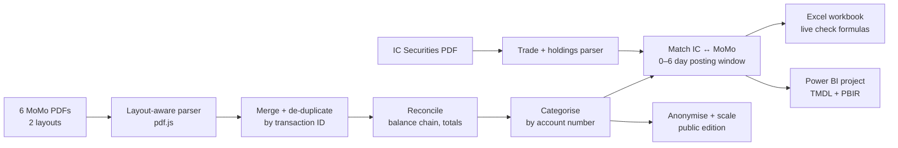
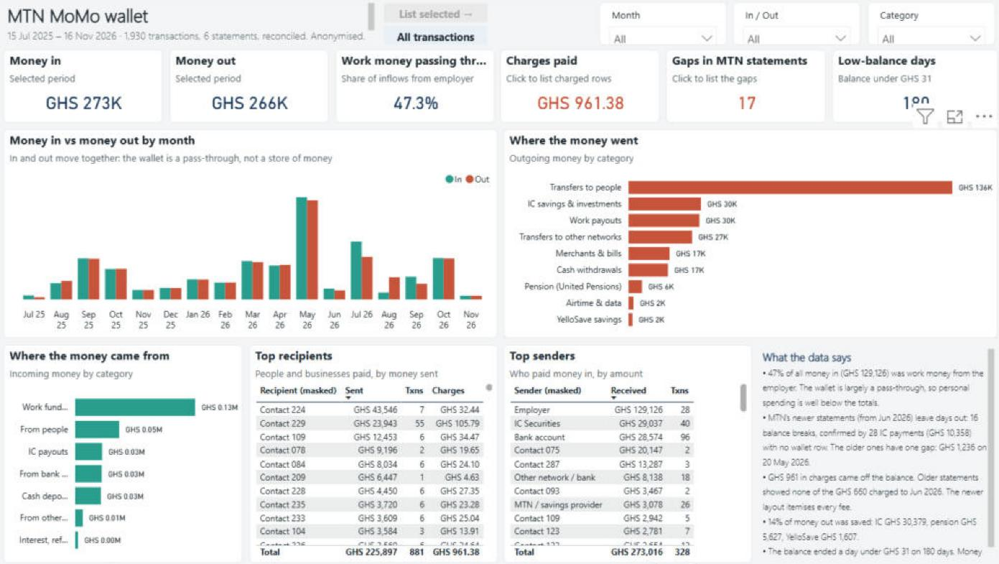
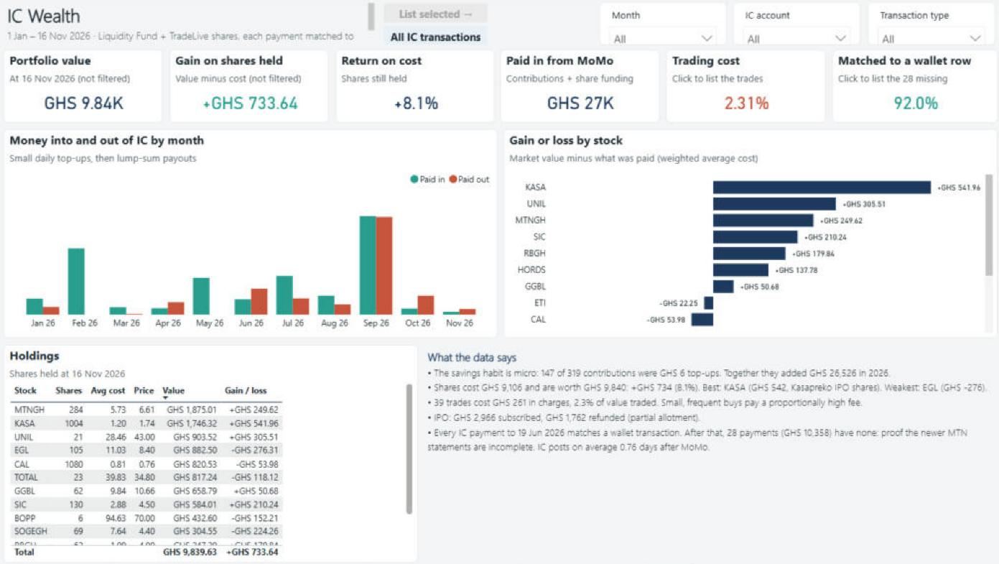
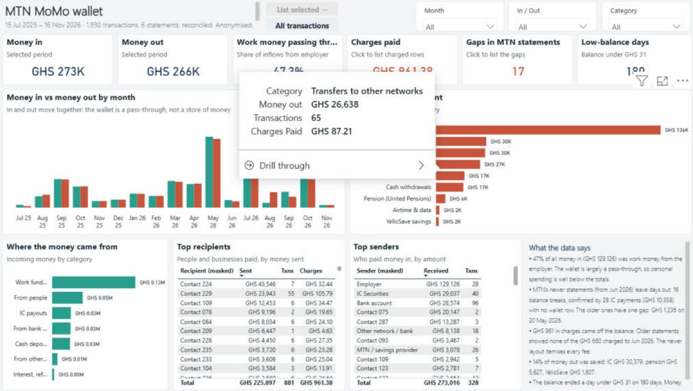
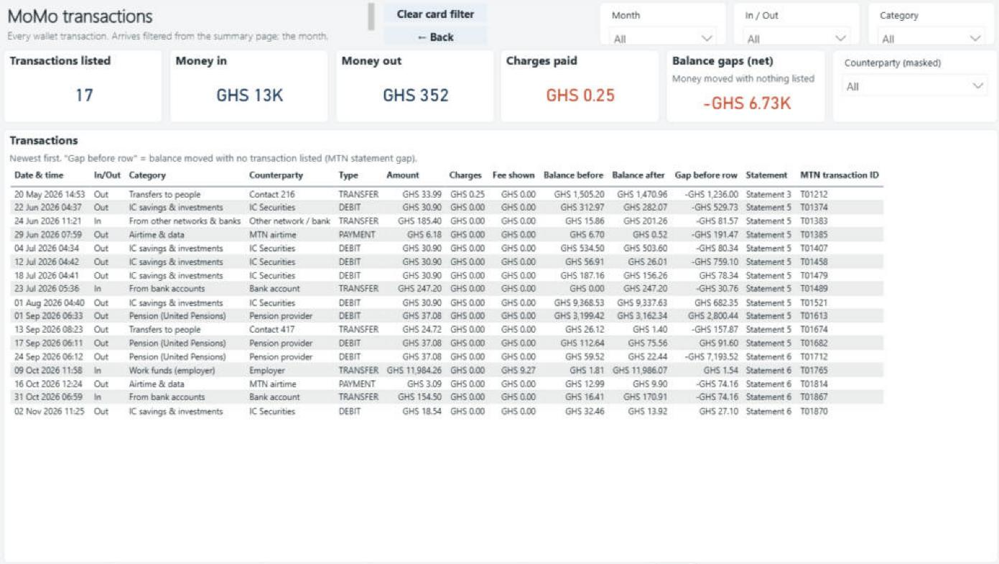

# Following the money

**I reconciled 17 months of my own mobile-money and investment statements down to the pesewa, and found what the statements leave out.**

Six MTN MoMo PDF statements and one IC Securities statement → a tested, de-duplicated dataset of **1,930 wallet transactions and 426 investment transactions** → an Excel workbook with live reconciliation checks and a four-page Power BI report with drill-through.

> This is a real dataset: my own. In this public version every person is replaced by a code (Contact 001 …), transaction IDs are re-keyed, and every cedi amount is multiplied by one undisclosed factor. Counts, percentages, patterns and every check are unchanged.

---

## What I found

| | Finding | How I know |
|---|---|---|
| 1 | **MTN's newer statements leave transactions out.** From June 2026 the statement layout changed. In the 151 days it covers, 54 days show no transactions and the balance chain breaks 16 times. | 28 payments recorded by IC Securities left the wallet but are missing from the MoMo statement. Up to June, all 218 IC payments match. |
| 2 | **One unexplained debit in the older statements:** a round sum on 20 May 2026 with no transaction listed. | It is the only break in 1,373 consecutive balances. Ruled out: transfer (227 of 227 transfers over GHS 100 carry a charge; this has none), cash-out, IC payment, reversal. |
| 3 | **The older statements hid the charges.** On 383 transactions the balance fell by more than the amount sent, while the Fee column read zero. The fees the column *did* show were paid by merchants, not the wallet. The newer layout fixed this. | Charge = balance fall − amount sent, tested on every outgoing row. In the newer layout it equals the Fee column on all 172 charged rows. |
| 4 | **47% of money in was work money passing through.** Money in and out track each other month by month, so the headline totals overstate personal spending. | Inflows categorised by sender account; employer account recognised in both layouts. |
| 5 | **14% of outflows were saved, in very small steps:** daily pension contributions, YelloSave, and IC top-ups (147 of 319 at the smallest size). | Debits keyed on the receiving account number, which both layouts keep. |
| 6 | **Shares +8.1% on cost, but trading costs ~2.3% each way**, whatever the trade size. | 39 trades parsed from free-text descriptions; consideration ± charges = cash moved on every one. |

## How it works



**Extraction.** The statements wrap long names onto several lines above and below each row. The parser reads each page's own header to find the 16 columns, anchors every row on its date, and attaches wrapped text blocks by their vertical centre. Testing caught two traps: a name containing the word "OVA" being read as a column header, and a seven-line name leaking into the row above.

**Two layouts, three quirks.** MTN's newer layout prints dates differently, swaps Balance Before/After on some incoming rows (2 found and corrected), and shows only first names, with the account holder's own name on every incoming row. Full names were rebuilt by learning each account number's name from the older statements: that recovered 91% of incoming value.

**Matching.** Investment payments are matched to wallet rows by amount and direction. In date order, each IC row takes the earliest unused wallet row it could have come from (IC posts 0–6 days after the wallet, never before). Anything outside that window is reported as missing, never forced into a match.

## Every number is checked twice

Once in the pipeline, and again as live Excel formulas and DAX measures.

| Test | Result |
|---|---|
| Rows extracted = dates printed on each PDF page | ✅ 250 / 325 / 374 / 533 / 324 / 241 |
| Money in, out, opening and closing balance per statement | ✅ all 6 |
| Overlapping statements: duplicates identical, none left twice | ✅ 117 removed |
| Opening + in − out − charges ± breaks = closing | ✅ difference 0.00 |
| Balance-before = previous balance-after (1,929 links) | ⚠️ 17 breaks, all in MTN's own statements |
| IC rows numbered without gaps; totals = IC's printed totals | ✅ 349 + 77 |
| Each trade: consideration ± charges = cash moved | ✅ 39 of 39 |
| IC payments matched to a wallet row (to 19 Jun 2026) | ✅ 218 of 218 |
| Public edition contains no names, phone or account numbers | ✅ automated scan |

## The report

Four pages, 35 DAX measures, synced slicers (month, direction, category, IC account, transaction type) and drill-through:

- **MTN MoMo wallet:** money in vs out by month, where it came from and went, top senders and recipients, statement gaps.
- **IC Wealth:** money in and out of IC, gain/loss by stock, holdings.
- **MoMo transactions / IC transactions:** the detail behind any bar. Click a bar and then **List selected →**, or click a red card: *Gaps in MTN statements* opens the 17 gap rows, *Matched to a wallet row* opens the 28 missing IC payments, and *Trading cost* opens the trades.





Hover any bar to drill through to its transactions:



Clicking *Gaps in MTN statements* lists the 17 rows where MTN's balance chain breaks, with the gap shown before each row:



*In Power BI Desktop, hold **Ctrl** while clicking a button or card (in the published report a normal click works).*

## Repository

```
Data/                         anonymised CSVs the report reads
MoMo & IC Money Report (Public).pbip   Power BI project: open in Power BI Desktop, set the DataFolder
                                       parameter to this repo's Data folder (Transform data > Edit
                                       parameters), then Refresh
pipeline/                     Node.js scripts: extract → reconcile → match → analyse → Excel / Power BI
Following the Money - Case Study (Anonymised).pdf   7-page write-up
```

To run the pipeline on your own statements: `npm install`, put the PDFs in `./statements/`, set `OWN_ACCT` (your wallet's account number) and the placeholders marked in the scripts, then run `npm run extract`, `npm run ic`, `npm run match`, `npm run analyse`.

## Tools

JavaScript (Node.js, pdf.js, ExcelJS) · Excel (live check formulas) · Power BI (DAX, TMDL, PBIR, drill-through, bookmarks) · data quality testing and reconciliation · anonymisation

## What I would do next

- Request complete statements from MTN for June–November 2026 and re-run: the pipeline will show whether every gap closes.
- Schedule the monthly run so a new break in the balance chain is flagged the day the statement arrives.

---

**Mega Anokye**, Data Analyst, Accra · [github.com/Mega-Anokye](https://github.com/Mega-Anokye)

At work I train a 200+ sales force across 5 branches and coach 14+ area sales managers on Power BI. I also build automation in Power Automate: a five-stage payment-approval workflow with a verification gate and full audit trail (Power Automate + SharePoint + Forms), automated invoice and leave approvals, validation checks that cut reporting errors by 25%, and an export-record reconciliation that lifted accuracy by 7%. This project applies the same habit to my own money: trust nothing until it reconciles.
